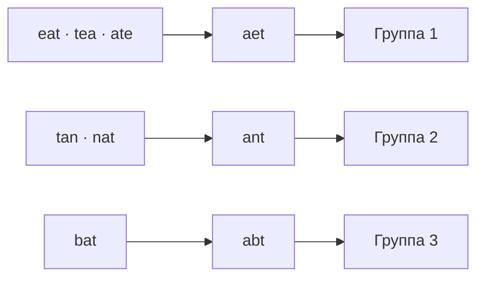

# Задача 2. Anagrams

Сгруппировать слова, состоящие из одинаковых символов в одинаковых количествах.

## Запуск

Из корня репозитория:

```bash
python3 homework_3/anagrams/solution.py
python3 -m unittest homework_3.anagrams.test_solution -v
```

`group_anagrams(strs)` возвращает новый список списков. Для примера из условия:

```python
[["eat", "tea", "ate"], ["tan", "nat"], ["bat"]]
```

Это эквивалентно ответу в задании: порядок групп и слов не оговорён.
Здесь сохраняем порядок первого появления групп и исходный порядок слов
в каждой группе. Повторы не удаляются, вход не изменяется.

## Идея и корректность

Каноническая подпись слова — его отсортированные символы:
`eat → aet`, `tea → aet`. Словарь связывает подпись со списком слов.
Создаём группу при первом появлении подписи, далее дополняем её.

Два слова — анаграммы тогда и только тогда, когда совпадают количества
каждого символа. Сортировка даёт одинаковую последовательность ровно в
этом случае. Значит, одинаковые подписи объединяют все и только анаграммы.
Каждое слово добавляется один раз, поэтому ничего не теряется и не дублируется.

Регистр, пробелы, пунктуация и Unicode-кодовые точки значимы:
`"Ab"` и `"ab"` различны; `"é"` и `"e\u0301"` различны.
Нормализация Unicode и выделение графем не выполняются. Кириллица и emoji
поддерживаются. Пустые строки образуют одну группу. Тип входа — `list[str]`.

## Визуализация

| Шаг | Слово | Подпись | Группа после добавления |
|---|---|---|---|
| 1 | eat | aet | eat |
| 2 | tea | aet | eat, tea |
| 3 | tan | ant | tan |
| 4 | ate | aet | eat, tea, ate |
| 5 | nat | ant | tan, nat |
| 6 | bat | abt | bat |



[Интерактивная лаборатория](../visualization/README.md) показывает
появление групп, их подписи и распределение слов с возможностью вернуться
к любому шагу. TS-модель сортирует по Unicode-кодовым точкам, как Python,
а не по UTF-16 кодовым единицам JavaScript.

## Сложность

Пусть `n` — число слов, `m` — максимальная длина.
Ожидаемое время `O(n · (1 + m log(m + 1)))`, обычно пишут `O(nm log m)`
для `m ≥ 2`. Более точная оценка —
`O(n + Σ |word| log(|word| + 1))`.
Сюда входят сортировка, сборка подписи и её хеширование.
При патологических коллизиях словаря возможна квадратичная по `n`
деградация, вплоть до `O(n² · (m + 1) + n · m log(m + 1))`.

Дополнительная память вместе с результатом — `O(n · (m + 1))`:
до `n` подписей и групп, `n` ссылок на исходные строки, временный список
символов длины до `m`. Сами слова не копируются. При пустом входе — `O(1)`.
Запись с `+1` учитывает пустые строки. Оценка не включает кадры интерфейса.

## Тесты

Пример условия, пустой список, пустые слова, повторяющиеся слова, одиночные
группы, кратность символов, регистр, пробелы, кириллица, emoji и отсутствие
неявной Unicode-нормализации. Проверяются порядок, сохранность входа и
независимость списков групп. Полный перебор коротких списков и 300 случайных
случаев сравниваются с независимым эталоном через частоты `Counter`.
Также проверяются 100 000 слов и слова длиной 10 001 символ.
