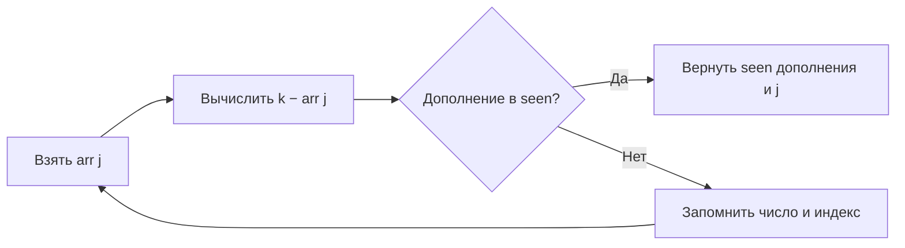

# Задача 1. Two sum

Даны целые `arr` и `k`. По условию существует ровно одна пара **различных**
индексов, сумма элементов которой равна `k`. Индексация с нуля.

## Запуск

Из корня репозитория:

```bash
python3 homework_3/two_sum/solution.py
# 1 2
# 0 1
python3 -m unittest homework_3.two_sum.test_solution -v
```

Функция `two_sum(arr, k)` возвращает кортеж `(i, j)`, где `i < j`.
`print(*two_sum(arr, k))` печатает ответ через пробел, как требует условие.
Массив не изменяется. На входе без решения функция вызывает `ValueError`.
Если нарушить гарантию единственности, возвращается первая найденная пара.
Проверка типов не нужна по контракту: массив содержит целые числа.

## Идея и корректность

Храним в словаре `seen` соответствие «число → индекс». Для `arr[j]` ищем
`k - arr[j]` среди уже просмотренных чисел. Если дополнение найдено,
возвращаем его индекс и `j`. Иначе запоминаем `arr[j]`.

Инвариант: перед итерацией `j` словарь содержит по одному индексу каждого
числа в префиксе `arr[:j]`. При успешном поиске сумма правильна, а сохранённый
индекс строго меньше текущего. Следовательно, элементы различны, индексы
упорядочены. Когда алгоритм дойдёт до правого элемента искомой пары,
левый уже будет в словаре — пара обязательно найдётся.

Проверяем дополнение **до вставки**, чтобы один элемент нельзя было
использовать дважды. Для `[5, 5]`, `k=10` второй элемент находит первый.
Повторная вставка числа обновляет его индекс; при единственной паре это
не мешает корректности.

## Визуализация

`arr = [1, 3, 4, 10]`, `k = 7`:

| j | arr[j] | Ищем | seen до проверки | Действие |
|---|---|---|---|---|
| 0 | 1 | 6 | `{}` | Запомнить `1 → 0` |
| 1 | 3 | 4 | `{1: 0}` | Запомнить `3 → 1` |
| 2 | 4 | 3 | `{1: 0, 3: 1}` | Найден индекс 1, ответ `1 2` |



[Интерактивная лаборатория](../visualization/README.md): массив,
подсветка текущего элемента и ответа, содержимое словаря, шаг назад,
перемотка, скорость и собственный ввод.

## Сложность

- Ожидаемое время `O(n)`: один проход, ожидаемое `O(1)` для операции словаря.
- Худший случай при патологических коллизиях — `O(n²)`.
- Дополнительная память `O(n)`; исходный массив не копируется.

Стандартная оценка считает арифметику и хеширование целого за `O(1)`.
Для чисел произвольной длины стоимость зависит также от количества бит.
Снимки состояний интерфейса не входят в оценку Python-алгоритма.

## Тесты

Примеры условия, два элемента, нули, одинаковые значения, отрицательные
числа, первая/последняя позиция, огромные целые, отсутствие пары, пустой
массив, единственный элемент и неизменность входа. Полный перебор массивов
длины 0–5 со значениями −2…2 и целей −4…4 сравнивается с квадратичным
эталоном. Дополнительно 500 случайных случаев с seed 301 и 100 000 элементов.
